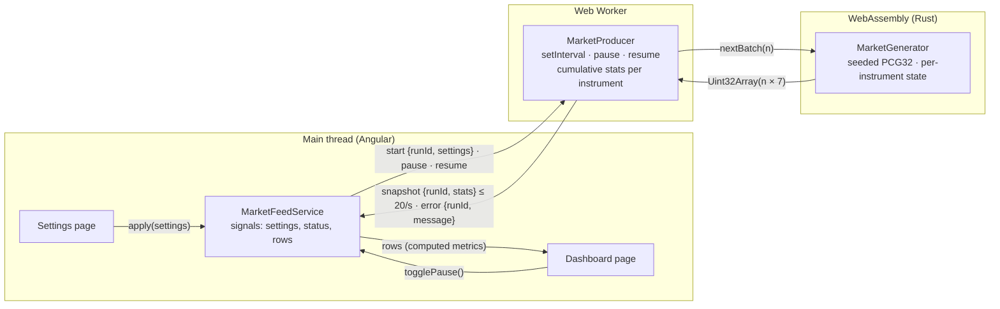

# Realtime Fintech Dashboard

An Angular application with a live market dashboard and data-producer settings. Simulated market updates come from a
WebAssembly library written in Rust that runs inside a Web Worker.

**Live demo:** https://kiforks.github.io/realtime-fintech-dashboard/

## What it does

- **Dashboard** — one row per fictional instrument with the last traded price, the bid–ask spread, the cumulative
  trading volume, the cumulative VWAP and the order-book imbalance. Before data arrives, and whenever a formula's
  denominator is zero, a value shows `—`; volume starts at `0`. Prices render as US dollars, the imbalance as a signed
  ratio between −1 and +1.
- **Producer status and Pause / Resume** — pausing stops generation; resuming keeps every value and total and does not
  generate anything for the paused time.
- **Settings** — a validated form for the instrument count (1–50), updates per batch (1–1000) and batch interval
  (50–2000 ms), all whole numbers. Editing does not touch the producer; **Apply** starts a new run, clears the
  previous run's values and totals (also when the producer was paused) and opens the dashboard.
- The app starts with the defaults (5 instruments, 100 updates every 500 ms). Navigating between pages keeps the
  active run and its running or paused state and never creates another producer.

## Architecture



1. **Rust generates, the worker accumulates, Angular derives.** `MarketGenerator` returns a batch of `n` market updates
   as one flat `Uint32Array` with stride 7: `[instrument, priceCents, tradeQuantity, bidCents, askCents, bidQuantity,
askQuantity]`. `MarketProducer` folds every trade into seven numbers per instrument (latest quote, last price,
   volume and `Σ(price × quantity)`) and posts the cumulative stats once per batch. The main thread turns stats into
   metrics in a `computed` signal.
2. **The UI cost does not depend on the generation rate.** The worker sends at most one message per batch interval
   (≤ 20 per second) with at most 50 rows, whatever the number of updates per batch. Every trade is counted in the
   worker, so a slower UI can never lose volume, and no event history is kept.
3. **One producer for the application's lifetime.** `MarketFeedService` is a root service created by an app
   initializer; it owns the only worker. Pages hold no state and provide nothing, so navigation cannot create a second
   producer.
4. **Runs are epochs.** Every `apply` increments a `runId`; the worker tags each event with the run that produced it and
   the service drops events of any other run, so a late result of a previous run never overwrites the new one.
   Commands need no `runId` because the worker processes them in order.
5. **The Wasm module is inlined into the worker chunk.** Angular's `loader: { ".wasm": "binary" }` turns the module into
   bytes that the worker passes to wasm-bindgen's `initSync`. There is no fetch, so there are no base-href, MIME type or
   cache mismatches on GitHub Pages, and the unit tests load the compiled module the same way.

**Cleanup and errors.** A new run frees the previous Wasm generator (`free()`). A generator that cannot be created or a
batch that fails posts an `error` event with its message. Any failure of the current run — that event or a crashed
worker — terminates the worker, so a Wasm instance left broken by a trap is never reused; the next **Apply** starts a
fresh worker. The dashboard shows the failure in an alert and disables Pause. The worker is terminated when the
application is destroyed.

## Metrics

| Metric            | Formula                                                     | Unavailable when            |
| ----------------- | ----------------------------------------------------------- | --------------------------- |
| Last traded price | price of the latest trade                                   | no trade yet                |
| Bid–ask spread    | `askCents − bidCents`                                       | no quote yet                |
| Trading volume    | `Σ tradeQuantity` since the run started                     | never (starts at `0`)       |
| VWAP              | `Σ(priceCents × tradeQuantity) / Σ tradeQuantity`           | volume is `0`               |
| Imbalance         | `(bidQuantity − askQuantity) / (bidQuantity + askQuantity)` | no quote yet, or both are 0 |

Prices stay in integer cents end to end; VWAP keeps fractional cents and rounding happens only when a value is
displayed (cents are rounded first, then divided by 100). Book quantities never add to the volume. `Σ(price × quantity)`
stays an exact integer below 2⁵³: with mid prices capped at $1000 that is at least ~12.5 hours at the maximum rate on a
single instrument; past that point the relative error is far below one cent.

## Market generator (Rust)

Each update picks an instrument at random (an instrument may appear several times in a batch) and moves its mid price
by at most `max(1, mid / 2000)` cents inside a $10–$1000 band, so prices evolve from their previous values. The spread
is 1–`mid / 1000` cents with `bid = mid − spread / 2` and `ask = bid + spread`, so the bid is always positive and below
the ask. The trade happens at that update's bid or ask, trade quantities are 1–100, and book quantities random-walk in
0–5000. All randomness comes from a PCG32 seeded per run (`crypto.getRandomValues` in the worker, fixed seeds in tests);
there is no `getrandom` dependency.

## Performance

Measured on the production build in headless Chromium (Apple Silicon) at the maximum load — 50 instruments, 1000
updates every 50 ms (20,000 updates per second) — over 10 seconds:

| Frames per second | p95 frame | Worst frame | Long tasks (> 50 ms) |
| ----------------- | --------- | ----------- | -------------------- |
| 165               | 6.4 ms    | 12.2 ms     | 0                    |

The worker chunk with the inlined Wasm module is about 34 kB raw (14 kB compressed).

## Tests

| Requirement                                           | Where                                                                       |
| ----------------------------------------------------- | --------------------------------------------------------------------------- |
| Metrics: worked example, zero denominators, isolation | `market-metrics.helper.spec.ts`                                             |
| Formatting: currency, signed imbalance, unavailable   | `cents.pipe.spec.ts`, `signed-ratio.pipe.spec.ts`, `dashboard-page` spec    |
| Settings validation and reset on Apply                | `settings-page` spec, `producer-settings.helper.spec.ts`, feed service spec |
| Pause / resume without catch-up                       | `market-producer.spec.ts` (fake timers), feed service and dashboard specs   |
| Rejection of results from a previous run              | `market-feed.service.spec.ts`                                               |
| One producer and paused state across navigation       | `root.component.spec.ts`                                                    |
| Generator: batch sizes, valid values, state, seeds    | Rust tests in `wasm/src/market.rs`, `market-generator.wasm.spec.ts`         |

Component specs drive the DOM through Angular CDK component harnesses. HappyDOM has no `Worker`, so the worker is
replaced through the `MARKET_WORKER_FACTORY` token, and `MarketProducer` is plain TypeScript tested with fake timers —
no test waits for real time. `market-generator.wasm.spec.ts` runs the compiled module and checks a fixed-seed batch
field by field, which guards the layout contract between Rust and TypeScript.

## Getting started

Requirements:

- Node.js 24 (see `.nvmrc`) and npm
- Rust through [rustup](https://rustup.rs/). `rust-toolchain.toml` pins Rust 1.99.1 with the `wasm32-unknown-unknown`
  target, clippy and rustfmt, so rustup installs the right toolchain on first use. With Homebrew, `rustup` is keg-only:
  add `$(brew --prefix rustup)/bin` to `PATH`.

`wasm-pack` comes from npm. `npm start`, `npm run build`, `npm test` and `npm run lint` rebuild the Wasm package first.

```bash
npm ci
npm start
```

The development server runs at http://localhost:4200/.

## Scripts

| Script               | What it does                                                                                                                |
| -------------------- | --------------------------------------------------------------------------------------------------------------------------- |
| `npm start`          | Development server with live reload                                                                                         |
| `npm run build`      | Production build into `dist/realtime-fintech-dashboard`                                                                     |
| `npm test`           | Unit tests (add `-- --coverage` for a coverage report)                                                                      |
| `npm run lint`       | Worker type check, ESLint, Stylelint and Prettier                                                                           |
| `npm run lint:fix`   | ESLint, Stylelint and Prettier with automatic fixes (no worker type check; run `npm run build:wasm` first on a clean clone) |
| `npm run build:wasm` | Build the Rust generator into `wasm/pkg` with wasm-pack                                                                     |
| `npm run test:wasm`  | Rust unit tests of the generator                                                                                            |
| `npm run lint:wasm`  | rustfmt and clippy checks                                                                                                   |

## Project structure

```
src/
  app/                        bootstrap: main.ts, app.config.ts, index.html
  pages/                      root shell (navigation + router outlet) and routes
  modules/market/
    entities/                 market domain: models, configs, helpers, pipes, feed service, worker
    pages/                    dashboard and settings pages
  shared/                     formatting pipes, number formats, global styles and theme tokens
wasm/                         Rust crate `market-generator`, compiled to WebAssembly
```

## Delivery

GitHub Actions runs on every push: rustfmt, clippy and the Rust tests, then lint, unit tests with coverage thresholds
and the production build. Every push to `main` (each merged pull request) deploys the build to GitHub Pages with an SPA
fallback for deep links: `404.html` is a copy of `index.html`, so a direct link such as `/settings` opens the right
page while GitHub Pages answers it with HTTP status 404. `main` is protected: changes arrive through pull requests
with a green `build` check.
