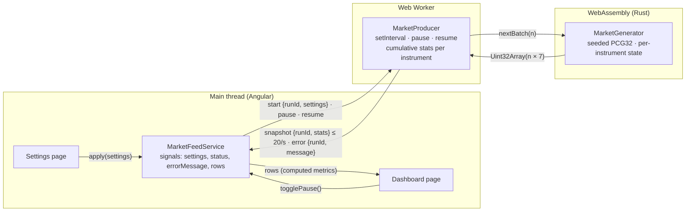

# Realtime Fintech Dashboard

An Angular application with a live market dashboard and data-producer settings. Simulated market updates come from a
WebAssembly library written in Rust that runs inside a Web Worker.

**Live demo:** https://kiforks.github.io/realtime-fintech-dashboard/

## What it does

- **Dashboard** — one row per fictional instrument with the last traded price, the bid–ask spread, the cumulative
  trading volume, the cumulative VWAP and the order-book imbalance. Before data arrives, and whenever a formula's
  denominator is zero, a value shows `—`; volume starts at `0`. Prices render as US dollars, the imbalance as a signed
  ratio between −1 and +1.
- **Producer status and Pause / Resume** — pausing stops generation; resuming keeps every value and total and does not
  generate anything for the paused time.
- **Settings** — a validated form for the instrument count (1–50), updates per batch (1–1000) and batch interval
  (50–2000 ms), all whole numbers. Editing does not touch the producer; **Apply** starts a new run, clears the
  previous run's values and totals (also when the producer was paused) and opens the dashboard.
- The app starts with the defaults (5 instruments, 100 updates every 500 ms). Navigating between pages keeps the
  active run and its running or paused state and never creates another producer.

## Architecture



1. **Rust generates, the worker accumulates, Angular derives.** `MarketGenerator` returns a batch of `n` market updates
   as one flat `Uint32Array` with stride 7: `[instrument, priceCents, tradeQuantity, bidCents, askCents, bidQuantity,
askQuantity]`. `MarketProducer` folds every trade into seven numbers per instrument (latest quote, last price,
   volume and `Σ(price × quantity)`) and posts the cumulative stats once per batch. The main thread turns stats into
   metrics in a `computed` signal.
2. **The UI cost does not depend on the generation rate.** The worker sends at most one message per batch interval
   (≤ 20 per second) with at most 50 rows, whatever the number of updates per batch. Every trade is counted in the
   worker, so a slower UI can never lose volume, and no event history is kept.
3. **One producer for the application's lifetime.** `MarketFeedService` is a root service; an app initializer calls its
   `start()`, which creates the only worker. Pages hold no state and provide nothing, so navigation cannot create a
   second producer. Templates read the feed through two structural directives of the market entity:
   `*appMarketFeed="let feed"` projects the service into the view, and `*appMarketFeedError="let message"` renders its
   content only while the run has failed.
4. **Runs are epochs.** Every `apply` increments a `runId`; the worker tags each event with the run that produced it and
   the service drops events of any other run, so a late result of a previous run never overwrites the new one.
   Commands need no `runId` because the worker processes them in order. Snapshots that were already on their way when
   the user paused are dropped, so a paused dashboard never changes; the next snapshot after Resume carries the
   cumulative totals.
5. **The Wasm module is inlined into the worker chunk.** Angular's `loader: { ".wasm": "binary" }` turns the module into
   bytes that the worker passes to wasm-bindgen's `initSync`. There is no fetch, so there are no base-href, MIME type or
   cache mismatches on GitHub Pages, and the unit tests load the compiled module the same way.

**Cleanup and errors.** A new run frees the previous Wasm generator (`free()`). A generator that cannot be created or a
batch that fails posts an `error` event with its message. Any failure of the current run — that event or a crashed
worker — terminates the worker, so a Wasm instance left broken by a trap is never reused; the next **Apply** starts a
fresh worker. The feed keeps the status and the error message in one state signal, so they cannot disagree. The
dashboard shows the failure in an alert and disables Pause. The worker is terminated when the
application is destroyed.

## Metrics

| Metric            | Formula                                                     | Unavailable when            |
| ----------------- | ----------------------------------------------------------- | --------------------------- |
| Last traded price | price of the latest trade                                   | no trade yet                |
| Bid–ask spread    | `askCents − bidCents`                                       | no quote yet                |
| Trading volume    | `Σ tradeQuantity` since the run started                     | never (starts at `0`)       |
| VWAP              | `Σ(priceCents × tradeQuantity) / Σ tradeQuantity`           | volume is `0`               |
| Imbalance         | `(bidQuantity − askQuantity) / (bidQuantity + askQuantity)` | no quote yet, or both are 0 |

Prices stay in integer cents end to end; VWAP keeps fractional cents and rounding happens only when a value is
displayed (cents are rounded first, then divided by 100). Book quantities never add to the volume. `Σ(price × quantity)`
stays an exact integer below 2⁵³: with mid prices capped at $1000 that is at least ~12.5 hours at the maximum rate on a
single instrument; past that point the relative error is far below one cent.

## Market generator (Rust)

Each update picks an instrument at random (an instrument may appear several times in a batch) and moves its mid price
by at most `max(1, mid / 2000)` cents inside a $10–$1000 band, so prices evolve from their previous values. The spread
is 1–`mid / 1000` cents with `bid = mid − spread / 2` and `ask = bid + spread`, so the bid is always positive and below
the ask. The trade happens at that update's bid or ask, trade quantities are 1–100, and book quantities random-walk in
0–5000. All randomness comes from a PCG32 seeded per run (`crypto.getRandomValues` in the worker, fixed seeds in tests);
there is no `getrandom` dependency. The generator checks its inputs at the Wasm boundary: an instrument count outside
1–50 or a batch size outside 1–1000 throws a readable error instead of a Wasm trap.

## Performance

Measured on the production build in headless Chromium (Apple Silicon) at the maximum load — 50 instruments, 1000
updates every 50 ms (20,000 updates per second) — over 10 seconds:

| Frames per second | p95 frame | Worst frame | Long tasks (> 50 ms) |
| ----------------- | --------- | ----------- | -------------------- |
| 165               | 6.4 ms    | 12.2 ms     | 0                    |

Rendering the table through the UI kit components costs no measurable time: at the same load, measured with the
Chrome DevTools Protocol over 10 seconds, the main thread is busy about 11% of the time (scripting about 2.3%) — the
same as before the UI kit (11%, 2.0%).

The initial bundle is about 290 kB raw (82 kB compressed); the settings page and the signal-forms code load lazily
(68 kB raw). The worker chunk with the inlined Wasm module is about 34 kB raw (14 kB compressed).

## Tests

| Requirement                                           | Where                                                                                  |
| ----------------------------------------------------- | -------------------------------------------------------------------------------------- |
| Metrics: worked example, zero denominators, isolation | `market-metrics.helper.spec.ts`                                                        |
| Formatting: currency, signed imbalance, unavailable   | `cents.pipe.spec.ts`, `signed-ratio.pipe.spec.ts`, `dashboard-page` spec               |
| Settings validation and reset on Apply                | `settings-page` spec, `integer-range.validator.spec.ts`, feed service spec             |
| Pause / resume without catch-up                       | `market.producer.spec.ts` (fake timers), feed service and dashboard specs              |
| Rejection of results from a previous run              | `market-feed.service.spec.ts`                                                          |
| One producer and paused state across navigation       | `app-root.component.spec.ts`                                                           |
| Generator: batch sizes, valid values, state, seeds    | Rust tests in `wasm/src/market.rs`, `market-generator.factory.spec.ts`                 |
| Accessibility: names, descriptions, roles, focus      | UI kit component specs (form, table, nav, alert), the page specs and the app root spec |

The unit tests run in **Vitest browser mode** in headless Chromium (Playwright provider), so they see real layout,
focus and the accessibility tree. Every component spec drives the DOM through a **page object** — a `*.po.ts` class
whose name ends in `PO` — and its locators come only from `page.getByTestId(...)`; `vitest-base.config.js` maps test
ids to the `data-po` attribute. Assertions use `expect.element(...)`, which retries until the view settles, so no spec
waits for real time. Doubles go through `MockProvider` from ng-mocks, and services a spec talks to are injected into
`let` variables in `beforeEach`. Test data comes from mock factories in `mocks/` (`MarketInstrumentStatsMock.create()`,
`.empty(symbol)`), which return plain objects, so `toStrictEqual` compares whole results.

The worker is replaced through the `MARKET_WORKER_FACTORY` token (exported from the market entity's `testing.ts`), and
`MarketProducer` is plain TypeScript tested with fake timers. `market-generator.factory.spec.ts` runs the compiled
module and checks a fixed-seed batch field by field, which guards the layout contract between Rust and TypeScript.

## Getting started

Requirements:

- Node.js 24.15 or a newer 24.x (`.nvmrc` names only the major version) and npm
- Rust through [rustup](https://rustup.rs/). `rust-toolchain.toml` pins Rust 1.99.1 with the `wasm32-unknown-unknown`
  target, clippy and rustfmt, so rustup installs the right toolchain on first use. The Rust scripts run through
  `scripts/with-rust.mjs`, which asks `rustup which cargo` for the pinned toolchain when `cargo` is not on `PATH`
  (Homebrew installs `rustup` keg-only), so no shell setup is needed.
- Chromium for the unit tests, once per machine: `npx playwright install chromium` (CI installs it itself).

`wasm-pack` comes from npm. `npm start`, `npm run build`, `npm test` and `npm run lint` rebuild the Wasm package first.

```bash
npm ci
npm start
```

The development server runs at http://localhost:4200/.

## Scripts

| Script               | What it does                                                                                                                |
| -------------------- | --------------------------------------------------------------------------------------------------------------------------- |
| `npm start`          | Development server with live reload                                                                                         |
| `npm run build`      | Production build into `dist/realtime-fintech-dashboard`                                                                     |
| `npm test`           | Unit tests (add `-- --coverage` for a coverage report)                                                                      |
| `npm run lint`       | Worker type check, ESLint, Stylelint and Prettier                                                                           |
| `npm run lint:fix`   | ESLint, Stylelint and Prettier with automatic fixes (no worker type check; run `npm run build:wasm` first on a clean clone) |
| `npm run build:wasm` | Build the Rust generator into `wasm/pkg` with wasm-pack                                                                     |
| `npm run test:wasm`  | Rust unit tests of the generator                                                                                            |
| `npm run lint:wasm`  | rustfmt and clippy checks                                                                                                   |

## Project structure

The application follows [Feature-Sliced Design](https://feature-sliced.design/) 2.1: four layers, and a module may
import only from layers below its own.

```
src/
  app/                        bootstrap, the app-root shell, routes with page titles, global styles and theme
  pages/
    dashboard/                dashboard page and its rate pipe
    settings/                 settings page, its draft model and helper, and the form schema
  entities/
    market/                   market domain: models, configs, mocks, metrics helper, feed service and directives,
                              worker factory token, generator factory, producer and the worker entry
  shared/
    ui/                       UI kit: alert, badge, button, form, nav, note, page, table
    validators/               reusable signal-form rules
    configs/, models/, pipes/, services/
wasm/                         Rust crate `market-generator`, compiled to WebAssembly
```

- **Pages first.** Code that only one page needs lives in that page's slice. There are no `features` or `widgets`
  layers, because no user action or block appears on more than one page. The market entity holds what both pages and
  the app need: the feed service, its directives and the domain model behind it.
- **Names carry their slice.** Every unit inside a slice starts with the slice name, in the file and in the symbol:
  `market-feed.service.ts` / `MarketFeedService`, `settings-draft.model.ts` / `SettingsDraft`,
  `dashboard-rate.pipe.ts` / `DashboardRatePipe`, `app-root.component.ts` / `AppRootComponent`. `shared` is exempt.
- **One unit per sub-folder.** Inside a slice, code is grouped by kind (`components/`, `directives/`, `services/`,
  `tokens/`, `factories/`, `producers/`, …), and every unit that has a spec gets its own sub-folder with an `index.ts`.
  A spec lives next to the unit it tests, in the same folder, together with its page object (`*.po.ts`) and, for a
  component or directive that needs a host, its host component (`*.spec.component.ts` with its
  `*.spec.component.html`). Each UI kit component with behaviour of its own (variants, ids, ARIA wiring) has its own
  spec; the purely presentational ones (badge, form, note, page, table, table row) are covered by the page specs.
  There are no module level specs.
- **Public API.** A slice is imported only through its `index.ts`; specs use its `testing.ts` (mocks, page objects, the
  worker token). Inside a slice, imports are relative; between slices, through the `~/` alias. A UI kit module is
  imported through `~/shared/ui/<module>`, so a page pulls in only the modules it uses and the signal-forms code stays
  in the lazily loaded settings chunk.
- **Enforced by ESLint.** `@kiforks/eslint-config/feature-sliced-design.js` checks the direction between layers;
  `eslint.config.js` adds three more checks: no import past a slice's, a shared segment's or a UI kit module's public
  API, no import of one page from another, and no import of one entity from another.

## UI kit and accessibility

Pages contain no styles. They compose `src/shared/ui`, whose components are plain attribute selectors that style
only their own host. The page picks the native element, so the markup keeps its semantics (a button style can sit on a
`button` or on a link) and the application renders no `div` or `span` at all. A variant input, such as the button
appearance or the cell type, becomes the host class as it is, and every component keeps its template in its own
`.html` file.

| Module   | Selectors                                                                                           | Used on                                         |
| -------- | --------------------------------------------------------------------------------------------------- | ----------------------------------------------- |
| `page`   | `[appPageHeader]`, `[appPageTitle]`                                                                 | `header`, `h1`                                  |
| `button` | `[appButton]`, `[appButton="primary"]`                                                              | `button`, `a`                                   |
| `badge`  | `[appBadge]`                                                                                        | `output` — the producer status, announced       |
| `note`   | `[appNote]`                                                                                         | `p`                                             |
| `alert`  | `[appAlert]` with `role="alert"`                                                                    | `p`                                             |
| `nav`    | `[appNavList]` (keeps list semantics with `role="list"`), `[appNavLink]` styled from `aria-current` | `ul`, `a`                                       |
| `table`  | `[appTableScroll]`, `[appTable]`, `[appTableCaption]`, `[appTableRow]`, `[appTableCell]`            | `section`, `table`, `caption`, `tr`, `th`, `td` |
| `form`   | `[appForm]`, `[appFormLabel]`, `[appFormInput]`, `[appFormError]`, `*appFormIfInvalid`              | `form`, `label`, `input`, `p`                   |

- The scrolling table region is focusable and named after its caption automatically: the caption takes a generated
  id and the region points `aria-labelledby` at it. Header cells carry `scope`.
- A label, its input and its error are linked through the unique name that signal forms give every field:
  `label[for]`, the input `id`, and `aria-describedby` / `aria-invalid` only while the error is shown (after the user
  leaves the field or submits). `*appFormIfInvalid` renders the error with the field state as its context, so the
  message reads the limits from the schema (`field.min()`, `field.max()`). Signal forms also set `required`, `min`
  and `max` on the input.
- Every route sets the document title, and after each navigation except the first, focus moves to the page content
  (`main`), so keyboard and screen reader users start on the new page. The current navigation link is marked by weight
  and an underline as well as by colour. Input and button borders use `--color-control-border`, which keeps a 3:1
  contrast in both themes, and all text meets 4.5:1. Every control shows one focus ring from the theme tokens; `main` is
  a focus target outside the tab order and has no ring. The styles use logical properties.
- Components rely on Angular 22's default `OnPush` change detection, so none of them sets `changeDetection`.

## Delivery

GitHub Actions runs on every push: rustfmt, clippy and the Rust tests, then lint, unit tests with coverage thresholds
and the production build. Every push to `main` (each merged pull request) deploys the build to GitHub Pages with an SPA
fallback for deep links: `404.html` is a copy of `index.html`, so a direct link such as `/settings` opens the right
page while GitHub Pages answers it with HTTP status 404. `main` is protected: changes arrive through pull requests
with a green `build` check.
